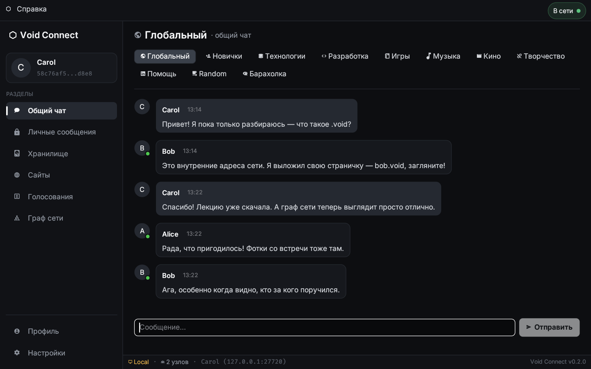

Первый публичный релиз **Void Connect** — децентрализованной P2P-сети для
локальной сети: общий и личный чат, обмен файлами, сайты `.void` и сеть
доверия — без центрального сервера.

## Скачать

| Файл | Для чего |
|---|---|
| `void-connect-0.2.0-x86_64.AppImage` | Linux — один файл со значком: `chmod +x`, запустить |
| `void-connect-0.2.0-linux-x86_64` | Linux — обычный бинарник: `chmod +x`, запустить |
| `void-connect-0.2.0-windows-x86_64.exe` | Windows 10/11 — запускается сразу |
| `SHA256SUMS.txt` | контрольные суммы |

- **Linux:** нужна glibc 2.35+ (Ubuntu 22.04+, Debian 12+, Fedora 36+, Arch).
  AppImage без FUSE: `--appimage-extract-and-run` или `libfuse2`.
- **Windows:** файл не подписан — на предупреждении SmartScreen нажмите
  «Подробнее» → «Выполнить в любом случае» и разрешите доступ в сеть.

Узлы в одной сети находят друг друга сами. Через интернет — Hamachi, Radmin
VPN или bootstrap-узлы, см. [README](https://github.com/the-void-fox/VoidConnect#readme).

## Что внутри

- **Общий чат** с каналами; сообщения подписаны ключом автора.
- **Личные сообщения** со сквозным шифрованием (X25519 + XChaCha20-Poly1305);
  от незнакомцев — в «Запросы», с «маркой работы» против спама.
- **Хранилище:** файлы делятся на чанки и раздаются всеми, кто их скачал.
- **Сайты `.void`:** опубликуйте папку со страницами — она откроется у других
  в браузере по имени.
- **Сеть доверия:** сверьте код безопасности со знакомым и поручитесь за него;
  доверие идёт по цепочке, незнакомцы ограничены, пока за них не поручатся.
  От доверия зависят лимиты чата, голоса и вес жалоб.
- **Граф сети:** настоящие соединения узлов (подтверждённые обоими концами)
  и поручительства, раскладка «физикой» как в Obsidian.
- **Голосования** за новые каналы и баны.

## Новое с прошлых сборок

- Новый дизайн: тёмная монохромная тема «Void», шрифт Inter, новая боковая
  панель, «пузырьки» сообщений; масштаб — Ctrl + / Ctrl −.
- Безопасность: владение ID узла теперь доказывается подписью; закрыты дыры,
  найденные при аудите (подмена узла, накрутка репутации подставными узлами).
- Граф сети: карта соединений рассылается между узлами; закрепление узлов —
  правой кнопкой.
- Иконка приложения; под Windows нет лишнего окна консоли.
- Исправлено: время входящих сообщений показывалось в UTC; окна настроек и
  профиля уходили за край экрана; в невысоком окне чат залезал на строку
  статуса; ошибка публикации файла или сайта была видна только в логе.

## Известные ограничения

- Сайты пока хранятся в памяти: после перезапуска узла сайт нужно
  опубликовать заново (имя `.void` при этом остаётся за вами). Исправим в
  следующей версии.
